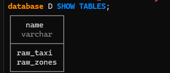
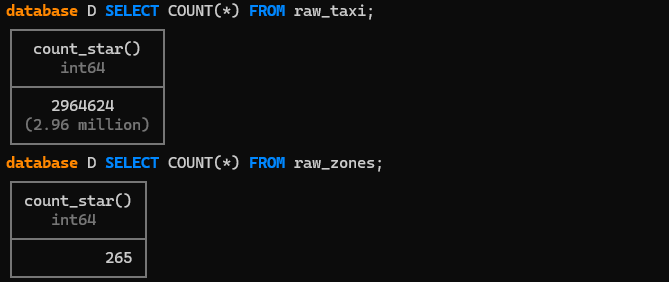
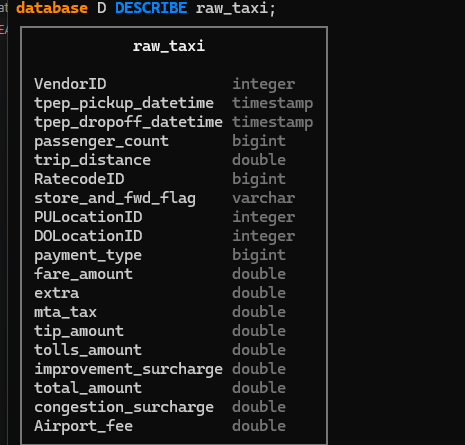

# Extract - Camada RAW

## Objetivo

Realizar a ingestão dos dados originais para o DuckDB, criando a camada **RAW**, sem qualquer transformação nos dados.

---


# Arquivos de Entrada

|----------|-----------|
| yellow_tripdata_2024-01.parquet | Dados das corridas de táxi |
| taxi_zone_lookup.csv | Tabela de zonas |
|----------|-----------|

---

# Script SQL

Arquivo:

```text
sql/01_raw.sql
```

```sql
CREATE TABLE raw_taxi AS
SELECT *
FROM read_parquet('data/yellow_tripdata_2024-01.parquet');

CREATE TABLE raw_zones AS
SELECT *
FROM read_csv_auto('data/taxi_zone_lookup.csv');
```

---

# Execução

O script foi executado no DuckDB através do comando:

```sql
.read sql/01_raw.sql
```
---

# Validação

## 1. Verificação das tabelas criadas

Consulta:

```sql
SHOW TABLES;
```

Resultado esperado:

- raw_taxi
- raw_zones



---

## 2. Quantidade de registros

Consultas executadas:

```sql
SELECT COUNT(*) FROM raw_taxi;

SELECT COUNT(*) FROM raw_zones;
```




---

## 3. Visualização dos dados carregados

Consulta:

```sql
SELECT *
FROM raw_taxi
LIMIT 5;
```


---

## 4. Banco utilizado

Consulta:

```sql
SELECT current_database();
```

Resultado esperado:

```text
database
```

---


## 5. Estrutura da tabela

Consulta executada:

```sql
DESCRIBE raw_taxi;
```

A consulta foi utilizada para verificar os nomes das colunas e seus respectivos tipos de dados importados para a camada RAW.

### Evidência



---

# Resultado

Após a execução do script:

-  Banco `database.duckdb` criado.
-  Arquivos importados com sucesso.
-  Tabela `raw_taxi` criada.
-  Tabela `raw_zones` criada.
-  Dados preservados em seu formato original (RAW).

---

# Conclusão

A etapa de **Extract** foi concluída com sucesso.

Os dados encontram-se armazenados na camada **RAW** e estão prontos para as próximas etapas do processo ELT: perfilamento, transformação, modelagem dimensional e análise.